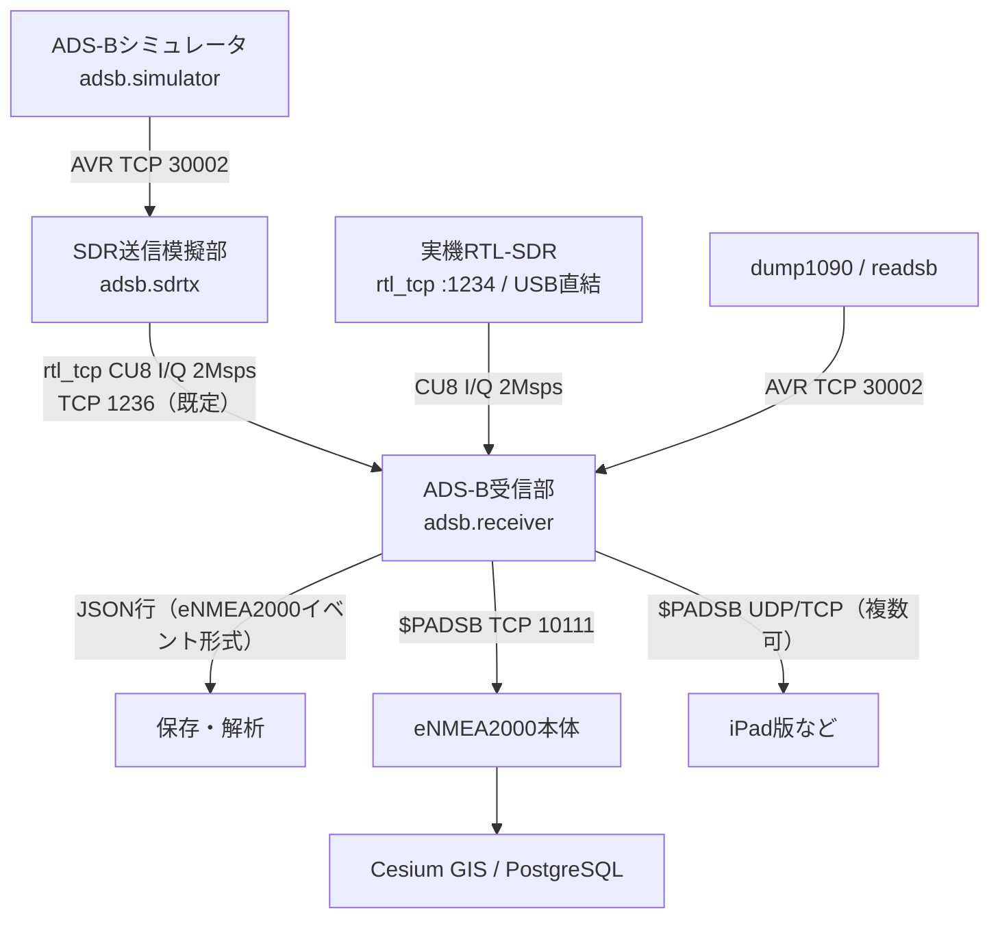

# eADSB2000 設計書：ADS-B受信システム＆シミュレータ

作成日：2026-10-13（日本時間）  
対象：[eNMEA2000](https://github.com/UeEmon/eNMEA2000)（NMEA0183/AIS）の構成を流用したADS-B（1090ES）受信・模擬環境。本リポジトリ eADS-B2000 は独立して動作し、eNMEA2000本体へはTCPで連接します。  
状態：**第2段階**（第1段階のコア実装に加え、`$PADSB` によるeNMEA2000でのネイティブ表示とDocker Compose化）。

## 1. 目的

- 航空機のADS-B（Mode S 拡張スキッタ DF17/18、1090 MHz）を受信・解析し、eNMEA2000の保存・GIS表示基盤へ載せる。
- 実機SDRがなくても試験できるよう、航空機トラフィックを生成するシミュレータと、PPM変調I/Qを作る送信模擬を持つ。
- コーディング補助にローカルLLM（Ollama）を使う。生成コードは必ず人がレビューし、テストで確認してから取り込む。

## 2. eNMEA2000との対応

AIS系の各構成に、ADS-B側の同じ役割の部品を置きます。

| eNMEA2000（AIS） | eADSB2000（ADS-B） | 実装 |
|---|---|---|
| eNMEA2000 `app/parser.py` NMEA/AISデコーダ | Mode S/1090ESデコーダ（CRC-24、DF17/18、CPR） | `adsb/modes.py` |
| AIS分割再構成・MMSI単位の情報統合 | ICAO単位の航空機状態（偶奇CPRペア、呼出符号、速度） | `adsb/tracker.py` |
| `app/store.py` のイベント行 | 同じ行形式（`sentence_type='ADSB'`、`icao`付き） | `adsb/mapping.py` `event_row` |
| NMEAエミュレータ（AIS船舶生成） | 航空機トラフィックシミュレータ | `adsb/simulator.py` |
| SDR送信模擬部（GMSK、9600bps） | PPM変調（2 Msps、CU8 I/Q） | `adsb/ppm.py` |
| SDR受信部（AIS-catcher） | 受信部（AVR入力 または I/Q復調） | `adsb/receiver.py` |
| — | ローカルLLMコーディング補助 | `adsb/ollama_assist.py` |

## 3. データ経路



- 既定の経路は eNMEA2000 のAIS系と同じ形です：シミュレータ → **SDR送信模擬部**（I/Qを rtl_tcp で配信）→ 受信部（復調）→ `$PADSB` → **eNMEA2000本体（TCP 10111）**。受信部の出力は常に本体へ入ります。
- 受信部は rtl_tcp 互換であれば送信模擬部と実機の `rtl_tcp` を区別しません。入力元を切り替えるだけで実機RTL-SDRへ移れます（7.2節）。
- `adsb/ppm.py` の復調器はベクトル化した最小実装で、2 Mspsを実時間の数十分の一で処理します。弱い電波の感度は dump1090／readsb が上なので、それらのAVR出力（TCP 30002）も受けられます。

## 4. 対応メッセージ（第1段階）

| DF/TC | 内容 | 解析 | 生成 |
|---|---|---|---|
| CRC-24 | パリティ検査（生成多項式 0x1FFF409） | ○ | ○ |
| DF17/18 TC1–4 | 航空機識別（呼出符号・カテゴリ） | ○ | ○ |
| DF17/18 TC9–18 | 空中位置（気圧高度、CPR偶奇） | ○（Q=1の25ft単位。Gillham符号は未対応） | ○ |
| DF17/18 TC20–22 | 空中位置（GNSS高度） | ○ | — |
| DF17/18 TC19 | 対地速度・針路・昇降率（サブタイプ1/2） | ○ | ○（サブタイプ1） |
| TC5–8 | 地上位置 | 未対応（第2段階） | — |
| DF4/5/20/21/11 | 応答・全呼出 | 未対応（アドレスパリティのため別処理） | — |

位置はCPRで符号化されており、1通だけでは位置が確定しません。

- **グローバル復号**：偶・奇フレームが10秒以内にそろったとき、新しい方の形式で緯度経度を確定します。
- **ローカル復号**：以後は前回位置（または受信局位置 `--ref`）を基準に1通で更新します（基準から180NM以内が前提）。
- 経度帯数NLは緯度0で59（規格の特例）です。

## 5. eNMEA2000への写像

### 5.1 イベント行（`event_row`）

`app/parser.Decoder.parse` と同じキーを持ちます。既存の `Store.add` へそのまま保存できる形です。

| キー | 値 |
|---|---|
| `sentence_type` | `ADSB` |
| `raw` | 112ビットフレームの16進文字列 |
| `status` / `checksum_valid` | CRC合格のみ `ok` / `true` |
| `latitude` / `longitude` | 航空機状態の最新位置（未確定なら `null`） |
| `mmsi` | `null`（航空機はICAOで識別） |
| `icao` | 24ビットICAOアドレス（16進6桁） |
| `decoded` | そのフレームの解析結果＋`aircraft`（呼出符号・高度・速度等の統合状態） |

`events` テーブルに `icao` 列はまだありません。第2段階でDB列・API・画面を追加します。

### 5.2 `$PADSB` 独自センテンス（`padsb`、既定）

eNMEA2000本体が航空機として直接解釈する独自センテンス（`$P` で始まるメーカー独自形式）です。受信部の既定の転送形式です。

```
$PADSB,ICAO,呼出符号,緯度,経度,気圧高度ft,対地速度kt,対地航跡度,昇降率ft/min,カテゴリ*hh
$PADSB,86D3A1,JAL123,35.549400,139.779800,12500,420.0,287.0,-1472,3*hh
```

- 緯度経度は符号付きの度（6桁）。不明な項目は空欄。NMEAと同じXORチェックサムです。
- eNMEA2000本体はICAOを `events.icao` 列に保存し、地図に航空機シンボル（「呼出符号 FL高度」）を描き、右側の航跡詳細に高度・速度・航跡・昇降率を表示します（eNMEA2000側の対応が必要です）。
- 位置が確定していない航空機は送信しません。1機あたり1秒に1回までです。

### 5.3 AISとの分離（AIS Type 9 ブリッジは廃止）

ADS-BはAISとは別のデータとして扱います。航空機をAIS Type 9（捜索救難航空機位置通報）に変換する機能は廃止しました（2026-10-14）。

- eNMEA2000本体とiPad版はどちらも `$PADSB` を直接受け、航空機をICAOアドレス単位の別トラックとして表示します。
- 疑似MMSIが実在の船舶・SAR機と区別できない、高度がAISの上限4094 mで切れる、という問題がなくなります。
- `--format ais9` と `ADSB_FORMAT` は削除しました。出力先の `/ais9` 指定はエラーになります。

## 6. シミュレータ

- 中心（既定：羽田 RJTT 35.5494, 139.7798）から半径60NM内に指定機数を配置し、大圏航法で移動、範囲外に出ると毎秒3度で中心方向へ旋回します。
- Web画面（6.2節）で設定した航空機は、設定時の位置から速度・針路・昇降率で推測航法を続けます（範囲外でも旋回しません）。
- ICAOは日本の割当ブロック（0x840000〜0x87FFFF）から乱数で採番、呼出符号は国内外航空会社の3レターコード＋便名です。
- 0.5秒ごとに位置（偶奇交互）と速度、5秒ごとに識別を送ります（実機の送信間隔に近い値）。
- 出力：AVRテキスト（標準出力、またはdump1090互換のTCPサーバ）、またはCU8 I/Qファイル（雑音・周波数ずれ指定可）。

### 6.1 SDR送信模擬部（`adsb.sdrtx`）

- シミュレータのAVR出力（TCP 30002）を受け、各フレームをPPM変調して、10 msごとのCU8 I/Qブロックへ無作為な位置で重ねます。雑音・振幅・周波数ずれを指定できます。
- I/Qは **rtl_tcp互換サーバ（TCP 1236）** で実時間に合わせて配信します（`RTL0`ヘッダ、周波数・サンプルレート・利得コマンドを受付）。受信部・dump1090 `--net-rtltcp` などの rtl_tcp クライアントがそのまま接続できます。
- 同時接続は1クライアント。未接続中のフレームは捨て、2秒以上滞留したフレームも捨てます（eNMEA2000の送信模擬部と同じ方針）。
- 2 Msps・1090 MHz以外を要求されたら警告します。

### 6.2 シミュレータWeb画面（`adsb.simweb`）

- `python -m adsb.simulator --web 8091 --state fleet.json`、Composeでは http://localhost:8091 です。eNMEA2000のNMEAエミュレータと同じくログインはなく、localhostにだけ公開します。
- 複数機の諸元（ICAO、呼出符号、緯度、経度、気圧高度ft、対地速度kt、針路°、昇降率ft/min、カテゴリ）を表またはCSV貼り付けで一括設定します。適用すると機体群を丸ごと置き換え、1件でも不正値があれば何も変えません。
- 位置は時刻の経過に合わせて推測位置で更新し、画面にも現在の推測位置を表示します。
- 設定は `--state` のJSON（Composeでは `sim-data` ボリュームの `/data/fleet.json`）に保存し、再起動後も同じ機体群から再開します。
- API：`GET /api/aircraft`（現在状態）、`PUT /api/aircraft`（`{"aircraft": [...]}` で一括置換）、`POST /api/aircraft/random`（`count`・`lat`・`lon`・`radius_nm` で乱数生成）。書込みは `Content-Type: application/json` のみ受け付けます。
- 範囲：緯度±90、経度±180、高度0〜50000 ft、速度0〜1000 kt、針路0〜360°、昇降率±32000 ft/min、カテゴリ0〜7、最大500機（DF17で表せる範囲）。

**I/Qはソフトウェア試験専用です。1090 MHzでの電波発射は電波法上許されません。** eNMEA2000のSDR送信模擬部と同様、RF送信機・アンテナへは出力しません。

## 7. 使い方

```bash
python -m pip install -r requirements-dev.txt
python -m pytest -q

# 1) シミュレータ → 受信部（AVR/TCP）
python -m adsb.simulator --count 20 --tcp 30002 &
python -m adsb.receiver --avr-tcp localhost:30002

# 2) 受信部 → eNMEA2000本体（$PADSB）。本体を起動しておく
python -m adsb.receiver --avr-tcp localhost:30002 --forward localhost:10111 --quiet

# 3) I/Qで変復調まで試験
python -m adsb.simulator --count 8 --seconds 30 --iq traffic.cu8 --noise 0.03
python -m adsb.receiver --iq traffic.cu8

# 4) SDR送信模擬部（rtl_tcp 1236）経由で受信
python -m adsb.sdrtx --avr-tcp localhost:30002 --rtltcp 1236 &
python -m adsb.receiver --rtltcp localhost:1236 --forward localhost:10111

# 5) 実機RTL-SDR（7.2節）
python -m adsb.receiver --rtlsdr 0 --forward localhost:10111              # USB直結（rtl_sdr コマンドが必要）
python -m adsb.receiver --rtltcp <rtl_tcpのIP>:1234 --forward localhost:10111
python -m adsb.receiver --avr-tcp <readsbのIP>:30002 --ref 35.55,139.78 --forward localhost:10111
```

### 7.1 Docker Compose

```bash
# 先にeNMEA2000本体を起動（TCP 10111）。その後:
docker compose up -d --build --wait
# 既定：simulator → sdr-tx（rtl_tcp 1236）→ receiver → 本体 TCP 10111
```

| 変数 | 既定値 | 内容 |
|---|---|---|
| `ADSB_COUNT` / `ADSB_LAT` / `ADSB_LON` / `ADSB_RADIUS_NM` | 20 / 35.5494 / 139.7798 / 60 | シミュレータの機数・中心・半径 |
| `ADSB_BIND` | 127.0.0.1 | シミュレータのAVR出力（30002）とWeb画面の公開先 |
| `ADSB_WEB_PORT` | 8091 | シミュレータWeb画面のホスト側ポート（6.2節） |
| `ADSB_TX_AMPLITUDE` / `ADSB_TX_NOISE` | 0.6 / 0.02 | SDR送信模擬部の振幅・雑音 |
| `ADSB_INPUT` | `--rtltcp` | 受信部の入力種別（`--rtltcp` または `--avr-tcp`） |
| `ADSB_SOURCE` | sdr-tx:1236 | 受信部の入力元 `host:port` |
| `ADSB_USB_DEVICE` | 0 | USB直結時のRTL-SDR番号（`compose.usb.yaml`） |
| `ADSB_OUTPUTS` | tcp://host.docker.internal:10111 | 出力先（複数可、7.3節） |
| `ENMEA_TARGET` | host.docker.internal:10111 | `ADSB_OUTPUTS` 未指定時の本体TCP（旧設定との互換用） |

eNMEA2000の `bash Loop-Back.sh` は、eNMEA2000と同じ階層に本リポジトリ（`eADS-B2000`）がある場合、または `ADSB_DIR` を指定した場合に、このComposeも起動します。

受信部は入力元が切断されると5秒ごとに再接続し、転送先へは送信失敗のたびに接続し直します。

### 7.2 実機RTL-SDR

1090 MHz用のアンテナとRTL-SDRドングルを使います。**AIS（162 MHz）とADS-B（1090 MHz）を同時に受けるにはドングルが2本必要です**（1本で両方は受けられません）。2本目は `-d 1` などで指定します。

```bash
# Mac（Docker DesktopはUSBを渡せないため、端末で rtl_tcp を動かす）
brew install librtlsdr
rtl_tcp -a 0.0.0.0 -p 1234 -s 2000000 -f 1090000000 -d 0
ADSB_SOURCE=host.docker.internal:1234 docker compose up -d --build --no-deps receiver

# Linux（USBをコンテナへ直結）
docker compose -f compose.yaml -f compose.usb.yaml up -d --build --no-deps receiver

# dump1090/readsb を使う場合（AVR生出力）
ADSB_INPUT=--avr-tcp ADSB_SOURCE=192.168.1.50:30002 docker compose up -d --build --no-deps receiver
```

いずれも出力は `$PADSB` として eNMEA2000本体（TCP 10111）へ入ります。eNMEA2000の `Loop-Back.sh` からは `ADSB_RTL_TCP=host.docker.internal:1234` で同じ切替ができます。

### 7.3 複数の出力先（本体＋iPad等）

受信部は、本体以外にもiPadなど複数の宛先へ同時に出力できます。`--output`（Composeでは `ADSB_OUTPUTS`）に、カンマ区切りで `プロトコル://ホスト:ポート` を並べます。どの宛先にも `$PADSB` を送ります。

| 項目 | 指定 |
|---|---|
| プロトコル | `tcp`（接続して送信、切断時は5秒後に再接続）、`udp`（ユニキャスト） |
| 件数 | 制限なし。1つの宛先が落ちても他の宛先への送信は続く |

```bash
# 本体（TCP）と iPad 2台（UDP）へ同時出力。すべて $PADSB
ADSB_OUTPUTS="tcp://host.docker.internal:10111,udp://192.168.1.30:10110,udp://192.168.1.31:10110" \
  docker compose up -d --build --wait
```

iPadのアドレスはLANのIPです（iPad版の受信設定、初期値UDP 10110／TCP 10111）。iPad版は `$PADSB` を受けて航空機として表示します（eNMEA2000のiPad版の `$PADSB` 対応が必要です）。eNMEA2000の `Loop-Back.sh` から起動する場合も、同じ `ADSB_OUTPUTS` がそのまま効きます。

## 8. ローカルLLM（Ollama）による開発補助

### 8.1 方針

- Ollamaはユーザー端末（Mac、`http://localhost:11434`）で動かします。クラウドへソースを送りません（`:cloud` 付きモデルは外部サーバで動くため除外）。
- LLMの出力は**提案**として扱い、人がレビューし、既知の試験ベクトルで検証してから取り込みます。リポジトリへ自動書き込みはしません。
- 推奨モデル（端末に導入済み）：
  - `gpt-oss:20b` …… 既定。コード生成・レビュー。
  - `gemma4:26b-a4b-it-qat` …… 長い文脈（複数ファイル）を読ませる場合。
  - `gemma4:12b` …… 軽量・高速な下書き。

### 8.2 実例（本段階で実施）

CPRエンコーダ `cpr_encode` は `gpt-oss:20b` に下書きさせました。レビューで、経度帯数 `nl()` が赤道（緯度0）で60を返す誤りを見つけ、規格の特例（59）を加えて修正しています。修正は `test_nl_equator` と往復テストで確認しています。LLMの出力をそのまま信用しない理由の具体例です。

### 8.3 CLI

```bash
python -m adsb.ollama_assist "TC5-8の地上位置デコードを追加して" --file adsb/modes.py --model gpt-oss:20b > suggestion.md
```

`OLLAMA_HOST`（既定 `http://localhost:11434`）、`OLLAMA_MODEL`（既定 `gpt-oss:20b`）で変更できます。コンテナ内からは `http://host.docker.internal:11434` を指定します。

## 9. 段階計画

| 段階 | 内容 |
|---|---|
| 1（完了） | デコーダ／エンコーダ、航空機状態、写像、シミュレータ、PPM変復調、受信CLI、Type 9ブリッジ（段階3cで廃止）、Ollama補助、テスト |
| 2（完了） | `$PADSB`、Docker Compose化、eNMEA2000の `Loop-Back.sh` への組込み、eNMEA2000のDBへ `icao` 列と `?icao=` 絞り込み、本体GISの航空機シンボル・高度表示・航跡詳細 |
| 3a（本PR） | SDR送信模擬部（rtl_tcp 1236）、受信部の rtl_tcp／USB RTL-SDR 入力と逐次復調、Composeの既定経路を I/Q 経由に、`compose.usb.yaml` |
| 3c（本PR） | ADS-BをAISから分離（Type 9ブリッジを廃止し、iPadへも `$PADSB`） |
| 3b（一部） | シミュレータWeb画面（複数機の諸元の一括設定、推測位置の更新）。緊急スクォーク、TC5–8地上位置、TC28/29/31、DF4/5/20/21は未着手 |
| 4 | 実機検証（RTL-SDR + readsb、受信局位置、MLATなし）、AWS配備 |

## 10. 検証状況

- `tests/test_adsb.py`：公開資料の既知フレーム（KLM1023、52.2572N/3.91937E、159kt/182.88°/−832fpm）、CRC誤り検出、世界4地点のCPR往復、PPM変復調（雑音・20kHzずれ）、シミュレータ→受信→航空機状態→`$PADSB`、TCP転送、Ollama API呼出し（模擬サーバ）。
- `$PADSB` の書式・チェックサム、受信部から`$PADSB`のTCP転送。
- 複数出力：出力先指定の解釈と不正値の拒否、TCPとUDPへの`$PADSB`同時送信、接続できない宛先があっても他の宛先へ届くこと。
- `tests/test_simweb.py`：Web APIでの一括置換と保存・再読込、推測航法（1分後の位置・高度）、範囲外でも直進すること、不正値・重複・JSON以外の拒否、乱数生成、設定値がフレームに載ること。
- `tests/test_sdr.py`：逐次復調が一括復調と一致すること（区切り位置3通り）、送信模擬部→rtl_tcp→受信の全フレーム到達、未接続時の破棄、rtl_tcp以外のサーバの拒否。
- Docker Compose（シミュレータ→SDR送信模擬部→受信部→ホストのTCP 10111）で `$PADSB` が届くこと（GitHub Actionsの `docker` ジョブ）。
- eNMEA2000本体と連接し、地図に航空機と「呼出符号 FL高度」、航跡詳細が表示されること（eNMEA2000側のブラウザ試験）。
- 実機RTL-SDR（rtl_tcp／USB）、dump1090/readsbとの接続、Docker Desktop（Mac）、端末上のOllama CLI実行は**未確認**です。

## 11. 受信部の統合検討（結論：現状維持）

AIS（eNMEA2000のSDR受信部）とADS-B（本リポジトリの受信部）を1つにまとめられるか検討し、**現状の2受信部・ドングル2本構成を維持**すると決めました。

| 案 | 結果 | 理由 |
|---|---|---|
| 広帯域の常時モニタリング（1台で両帯域） | 不可 | 162 MHzと1090 MHzは約930 MHz離れている。RTL-SDR（約2.4 MHz）、Airspy（10 MHz）、HackRF（20 MHz）では同時に覆えない。掃引ではADS-Bの120 µsのバーストやAISのスロットを取りこぼす |
| 複数チャンネルの同時復調 | 帯域内は実施済み | AIS 1ch／2chはAIS-catcherがドングル1本で同時に復調している。帯域をまたぐ2チャンネル化はできない |
| 独立2チューナーの機器（SDRplay RSPduo、各2 MHz幅） | 保留 | 1台で両帯域を受けられる。ただし専用APIが必要で、Docker（MacのARM）での動作と、ADS-Bを2 MHz幅で受けたときの感度は未確認。AD9361系（USRP B210、bladeRF）は2系統の受信が局部発振器を共用するため対象外 |
| 受信ソフトの統合（ドングル2本のまま） | 見送り | 管理画面と設定は1つにできるが、現状でも両受信部とも本体のTCP 10111へ入っており、運用上の必要性が小さい |

## 参照

- Junzi Sun, *The 1090 Megahertz Riddle*（第2版） https://mode-s.org/1090mhz/
- RTCA DO-260B / EUROCAE ED-102A（1090ES MOPS）
- Ollama API https://github.com/ollama/ollama/blob/main/docs/api.md
