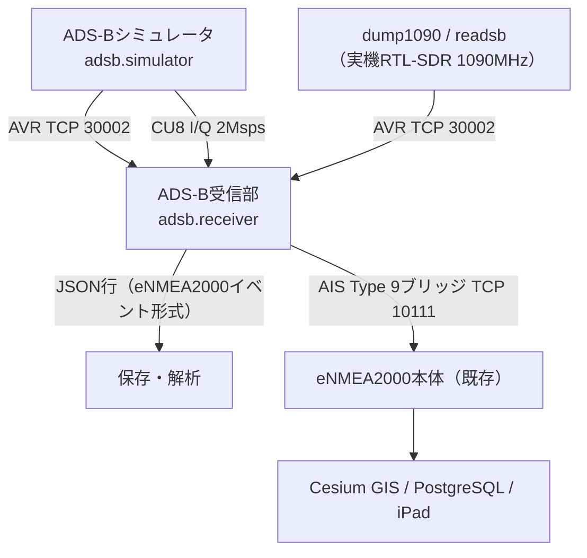

# eADSB2000 設計書：ADS-B受信システム＆シミュレータ

作成日：2026-10-13（日本時間）  
対象：eNMEA2000（NMEA0183/AIS）の構成を流用したADS-B（1090ES）受信・模擬環境  
状態：**第1段階（コア実装＝デコーダ・模擬・連接ブリッジ・LLM補助）**。Docker化・専用GISは第2段階以降。

## 1. 目的

- 航空機のADS-B（Mode S 拡張スキッタ DF17/18、1090 MHz）を受信・解析し、eNMEA2000の保存・GIS表示基盤へ載せる。
- 実機SDRがなくても試験できるよう、航空機トラフィックを生成するシミュレータと、PPM変調I/Qを作る送信模擬を持つ。
- コーディング補助にローカルLLM（Ollama）を使う。生成コードは必ず人がレビューし、テストで確認してから取り込む。

## 2. eNMEA2000との対応

AIS系の各構成に、ADS-B側の同じ役割の部品を置きます。

| eNMEA2000（AIS） | eADSB2000（ADS-B） | 実装 |
|---|---|---|
| `app/parser.py` NMEA/AISデコーダ | Mode S/1090ESデコーダ（CRC-24、DF17/18、CPR） | `adsb/modes.py` |
| AIS分割再構成・MMSI単位の情報統合 | ICAO単位の航空機状態（偶奇CPRペア、呼出符号、速度） | `adsb/tracker.py` |
| `app/store.py` のイベント行 | 同じ行形式（`sentence_type='ADSB'`、`icao`付き） | `adsb/mapping.py` `event_row` |
| NMEAエミュレータ（AIS船舶生成） | 航空機トラフィックシミュレータ | `adsb/simulator.py` |
| SDR送信模擬部（GMSK、9600bps） | PPM変調（2 Msps、CU8 I/Q） | `adsb/ppm.py` |
| SDR受信部（AIS-catcher） | 受信部（AVR入力 または I/Q復調） | `adsb/receiver.py` |
| — | ローカルLLMコーディング補助 | `adsb/ollama_assist.py` |

## 3. データ経路



- 実機受信は、実績のある dump1090／readsb に復調を任せ、その **AVR生フレーム出力（TCP 30002、`*8D...;`形式）** を受け取る構成を基本とします。AIS側でAIS-catcherに復調を任せたのと同じ考え方です。
- `adsb/ppm.py` の復調器は試験・ループバック用の最小実装です。実電波の性能は dump1090／readsb が上です。

## 4. 対応メッセージ（第1段階）

| DF/TC | 内容 | 解析 | 生成 |
|---|---|---|---|
| CRC-24 | パリティ検査（生成多項式 0x1FFF409） | ○ | ○ |
| DF17/18 TC1–4 | 航空機識別（呼出符号・カテゴリ） | ○ | ○ |
| DF17/18 TC9–18 | 空中位置（気圧高度、CPR偶奇） | ○（Q=1の25ft単位。Gillham符号は未対応） | ○ |
| DF17/18 TC20–22 | 空中位置（GNSS高度） | ○ | — |
| DF17/18 TC19 | 対地速度・針路・昇降率（サブタイプ1/2） | ○ | ○（サブタイプ1） |
| TC5–8 | 地上位置 | 未対応（第2段階） | — |
| DF4/5/20/21/11 | 応答・全呼出 | 未対応（アドレスパリティのため別処理） | — |

位置はCPRで符号化されており、1通だけでは位置が確定しません。

- **グローバル復号**：偶・奇フレームが10秒以内にそろったとき、新しい方の形式で緯度経度を確定します。
- **ローカル復号**：以後は前回位置（または受信局位置 `--ref`）を基準に1通で更新します（基準から180NM以内が前提）。
- 経度帯数NLは緯度0で59（規格の特例）です。

## 5. eNMEA2000への写像

### 5.1 イベント行（`event_row`）

`app/parser.Decoder.parse` と同じキーを持ちます。既存の `Store.add` へそのまま保存できる形です。

| キー | 値 |
|---|---|
| `sentence_type` | `ADSB` |
| `raw` | 112ビットフレームの16進文字列 |
| `status` / `checksum_valid` | CRC合格のみ `ok` / `true` |
| `latitude` / `longitude` | 航空機状態の最新位置（未確定なら `null`） |
| `mmsi` | `null`（航空機はICAOで識別） |
| `icao` | 24ビットICAOアドレス（16進6桁） |
| `decoded` | そのフレームの解析結果＋`aircraft`（呼出符号・高度・速度等の統合状態） |

`events` テーブルに `icao` 列はまだありません。第2段階でDB列・API・画面を追加します。

### 5.2 AIS Type 9 ブリッジ（`ais_type9`）

既存の本体・GIS・iPadを**無改修のまま**航空機表示に使うため、航空機状態を AIS Type 9（捜索救難航空機位置通報）の `!AIVDM` に変換し、本体のTCP 10111へ送ります。

- MMSIは疑似値 `100000000 + ICAO(10進)`。実在のMMSIと区別できないため、**試験用途に限定**します。
- 高度はAISの上限で0〜4094 mに丸めます。速度はノット（0〜1022）、針路は0.1度単位です。
- 1機あたり1秒に1回まで送信します。
- 既存 `app/parser.py` がType 9として受理することをテストで確認しています。

## 6. シミュレータ

- 中心（既定：羽田 RJTT 35.5494, 139.7798）から半径60NM内に指定機数を配置し、大圏航法で移動、範囲外に出ると毎秒3度で中心方向へ旋回します。
- ICAOは日本の割当ブロック（0x840000〜0x87FFFF）から乱数で採番、呼出符号は国内外航空会社の3レターコード＋便名です。
- 0.5秒ごとに位置（偶奇交互）と速度、5秒ごとに識別を送ります（実機の送信間隔に近い値）。
- 出力：AVRテキスト（標準出力、またはdump1090互換のTCPサーバ）、またはCU8 I/Qファイル（雑音・周波数ずれ指定可）。

**I/Qはソフトウェア試験専用です。1090 MHzでの電波発射は電波法上許されません。** eNMEA2000のSDR送信模擬部と同様、RF送信機・アンテナへは出力しません。

## 7. 使い方

```bash
python -m pip install -r requirements-dev.txt
python -m pytest -q tests/test_adsb.py

# 1) シミュレータ → 受信部（AVR/TCP）
python -m adsb.simulator --count 20 --tcp 30002 &
python -m adsb.receiver --avr-tcp localhost:30002

# 2) 受信部 → eNMEA2000本体（AIS Type 9ブリッジ）。本体を起動しておく
python -m adsb.receiver --avr-tcp localhost:30002 --forward localhost:10111 --quiet

# 3) I/Qで変復調まで試験
python -m adsb.simulator --count 8 --seconds 30 --iq traffic.cu8 --noise 0.03
python -m adsb.receiver --iq traffic.cu8

# 4) 実機：RTL-SDR + readsb/dump1090 の生出力を受信
python -m adsb.receiver --avr-tcp <受信機のIP>:30002 --ref 35.55,139.78 --forward localhost:10111
```

## 8. ローカルLLM（Ollama）による開発補助

### 8.1 方針

- Ollamaはユーザー端末（Mac、`http://localhost:11434`）で動かします。クラウドへソースを送りません（`:cloud` 付きモデルは外部サーバで動くため除外）。
- LLMの出力は**提案**として扱い、人がレビューし、既知の試験ベクトルで検証してから取り込みます。リポジトリへ自動書き込みはしません。
- 推奨モデル（端末に導入済み）：
  - `gpt-oss:20b` …… 既定。コード生成・レビュー。
  - `gemma4:26b-a4b-it-qat` …… 長い文脈（複数ファイル）を読ませる場合。
  - `gemma4:12b` …… 軽量・高速な下書き。

### 8.2 実例（本段階で実施）

CPRエンコーダ `cpr_encode` は `gpt-oss:20b` に下書きさせました。レビューで、経度帯数 `nl()` が赤道（緯度0）で60を返す誤りを見つけ、規格の特例（59）を加えて修正しています。修正は `test_nl_equator` と往復テストで確認しています。LLMの出力をそのまま信用しない理由の具体例です。

### 8.3 CLI

```bash
python -m adsb.ollama_assist "TC5-8の地上位置デコードを追加して" --file adsb/modes.py --model gpt-oss:20b > suggestion.md
```

`OLLAMA_HOST`（既定 `http://localhost:11434`）、`OLLAMA_MODEL`（既定 `gpt-oss:20b`）で変更できます。コンテナ内からは `http://host.docker.internal:11434` を指定します。

## 9. 段階計画

| 段階 | 内容 |
|---|---|
| 1（本PR） | デコーダ／エンコーダ、航空機状態、写像、シミュレータ、PPM変復調、受信CLI、Type 9ブリッジ、Ollama補助、テスト |
| 2 | Docker Compose化（`adsb/compose.yaml`）、`Loop-Back.sh` への組込み、DBへ `icao` 列とADS-B専用API、本体GISで航空機シンボル（MIL-STD-2525D 航空）・高度表示 |
| 3 | シミュレータWeb画面（機数・航路・緊急スクォーク）、RTL-TCP配信（dump1090へI/Qを直接供給）、TC5–8地上位置、TC28/29/31、DF4/5/20/21 |
| 4 | 実機検証（RTL-SDR + readsb、受信局位置、MLATなし）、AWS配備、iPad版への航空機表示 |

## 10. 検証状況

- `tests/test_adsb.py`：公開資料の既知フレーム（KLM1023、52.2572N/3.91937E、159kt/182.88°/−832fpm）、CRC誤り検出、世界4地点のCPR往復、PPM変復調（雑音・20kHzずれ）、シミュレータ→受信→Type 9→既存パーサ、TCP転送、Ollama API呼出し（模擬サーバ）。
- 実機RTL-SDR、dump1090/readsbとの接続、Docker環境、端末上のOllama CLI実行は**未確認**です。

## 参照

- Junzi Sun, *The 1090 Megahertz Riddle*（第2版） https://mode-s.org/1090mhz/
- RTCA DO-260B / EUROCAE ED-102A（1090ES MOPS）
- ITU-R M.1371-6（AIS Type 9）
- Ollama API https://github.com/ollama/ollama/blob/main/docs/api.md
