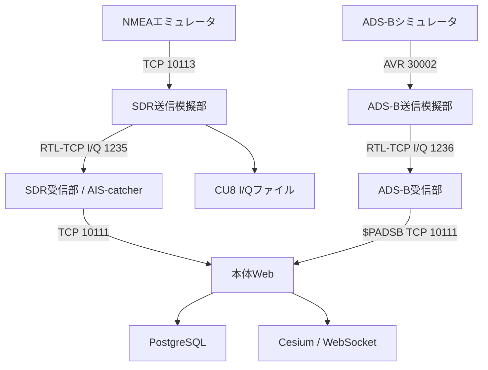

# eNMEA2000 開発・運用引き継ぎ書

作成日：2026-10-13（日本時間）  
対象：次の開発担当者・端末展開担当者・運用担当者  
リポジトリ：[UeEmon/eNMEA2000](https://github.com/UeEmon/eNMEA2000)（public）  
基準：main `5a0e9f2e7975bc5053dcf5f0a7a5fb119f15f674`（Loop-Back.sh導入後）

本書は基準コミットのコード・README・GitHub Actionsと、ユーザーから報告された端末ログに基づく引き継ぎ時点の記録です。以後の変更はコードと対象コミットのCIを確認してください。認証情報、Apple署名情報、AWSアカウント情報は本書に含めません。

## 1. 最初に行うこと

1. GitHubリポジトリを取得し、本書とルートREADMEを読む。
2. 試験用Docker環境で `bash Loop-Back.sh` を実行する。
3. NMEAエミュレータからAIS Type 5と位置通報を送信し、SDR経由で本体の受信履歴・DB・地図へ反映されることを確認する。
4. 既存環境を引き継ぐ場合は、秘密情報と永続ボリュームを別途受領し、変更前にバックアップする。
5. 第9節の既知課題を確認し、Mac／Windows・iPad実機・物理SDR・AWSの未確認項目を実環境で検証する。

現状はDockerのソフトウェア試験経路をCIで確認済みです。実機受信性能やAWS本番稼働の確認済みシステムとして扱わないでください。

## 2. システムの目的と構成

NMEA0183/AISをUDP・TCPでリアルタイム受信し、またはファイルから解析して保存・表示するシステムです。サーバ版とiPad単体版は同じリポジトリで管理しますが、実行環境と解析実装・DBは独立しています。

| 構成 | 実装・責務 | 主な入口 |
|---|---|---|
| 本体Web | Python 3.12 / FastAPI / Uvicorn、NMEA・AIS解析、PostgreSQL、REST・WebSocket | `app/main.py`、`app/parser.py`、`app/store.py` |
| 本体GIS | CesiumJS、Natural Earth II、航跡・監視・右側詳細 | `app/static/app.js`、`app/static/track-details.js` |
| NMEAエミュレータ | 独立Web、GIS航路操作、GPS/AIS生成、TCP/UDP外部出力 | `emulator/server.py`、`emulator/ais_suite.py` |
| SDR送信模擬部 | NMEA AISをGMSK変調、RTL-TCP I/Q配信、CU8ファイル生成 | `sdr-tx/server.py`、`sdr-tx/modulator.py` |
| SDR受信部 | AIS-catcherによる復調、NMEA検証・ログ・TCP/UDP配信、管理Web | `sdr/engine.py`、`sdr/core.py`、`sdr/service.py` |
| ADS-B（`adsb/`、旧eADS-B2000） | ADS-Bシミュレータ（複数機・Web 8091）、ADS-B送信模擬部（PPM I/Q 1236）、ADS-B受信部（`$PADSB`をTCP 10111へ） | `adsb/adsb/simulator.py`、`adsb/adsb/sdrtx.py`、`adsb/adsb/receiver.py` |
| iPad | Swift受信・解析・SQLite、SwiftUI、同梱CesiumをWKWebViewで描画 | `ipad/App/`、`ipad/Sources/` |
| AWS配備 | ECR、EC2、ALB、EBS、Secrets Manager、CloudWatch、SSM | `aws/deploy.py`、`aws/cloudformation.json`、`aws/bootstrap.sh` |

### 一括起動のデータ経路



5つのComposeプロジェクト（本体、エミュレータ、SDR受信部、SDR送信模擬部、ADS-B）は独立しています。連接は共有Dockerネットワークではなく `host.docker.internal` とホスト公開ポートを通ります。SDR受信部内部の `ais-receiver → nmea-router` は内部UDP 10112で接続します。

**SDR送信模擬部はソフトウェアI/Qを出力し、RF送信機・アンテナへ出力しません。** GPSセンテンスはAIS変調対象ではありません。AIVDOを変調した場合も復調後は他船AIVDMになるため、自己位置の試験には直接NMEA入力を使います。

### 実受信・iPadへの経路

物理SDR → ホストまたは外部受信端末のRTL-TCP／SpyServer → SDR受信部 → 本体またはiPadのLAN IP、という構成です。Mac／WindowsのDocker Desktopでは通常の構成でUSBを直接受信コンテナへ渡さず、ネットワーク入力を使用します。LinuxのUSB直結は `sdr/compose.usb.yaml` を追加します。

## 3. 実装済みの機能と境界

| 領域 | 実装済み | 注意点 |
|---|---|---|
| 受信 | UDP 10110、TCP 10111、チェックサム検証、送信元分離、停止・再開、有界キュー | UDP欠落の完全検知、切断時の自動再送はない |
| AIS | Type 1〜28および旧形式Type 0、分割再構成、24の形式分岐、25/26の可変長・通信状態処理 | 未知DAC/FIDの業務的意味をすべて展開するものではない |
| ファイル | 最大100 MB、同時2件、進捗・停止、原文保存、ジョブ保持 | ファイル時刻と受信時刻は区別。絶対日時を推測しない |
| GIS | Cesium同梱、Natural Earth II、航跡、針路、右クリック、右側詳細 | 海図ではない。日付変更線をまたぐ航跡分割は未対応 |
| シンボル | MIL-STD-2525D / APP-6D切替 | 表示用途。全面的な規格適合認証を示すものではない |
| 監視 | MMSI/IMOの別テーブル管理、編集・削除、重複時の更新/取消、受信アラート、GIS登録・中央選択 | 通知間隔は対象ごとに60秒。位置未受信なら中央表示できない |
| 履歴削除 | 件数・確認文字列を照合して受信履歴等を削除 | 監視リストと元ファイルは保持、削除後は受信停止 |
| エミュレータ | Type別UI、Type5項目入力、GIS操作、全タイプ42シナリオ、同心円配置・自動周回、外部出力 | すべての通報が位置を持つわけではない |
| iPad自己位置 | AIVDO・有効GPS、船舶/航空機選択、自己位置中心オン/オフ、他目標の方位・NM距離 | NMEAを位置源とする。端末GPSセンサーは使用しない |
| SDR | A/B同時復調、ログ、複数TCP/UDP宛先、I/Qファイル処理、変調模擬 | 実機互換性・電波性能は現地検証が必要 |

サーバ版の未知センテンスは `unsupported` として原文・列を残します。iPadの主要GPS解析はRMC/GGA/GLL/VTG/HDT/HDG/ZDAで、Python版と対応範囲が完全同一ではありません。

## 4. Docker環境を展開する手順

### 前提

Docker Desktop（Linuxコンテナ）またはDocker Engine、Compose v2、Git、Bashが必要です。Mac Apple Silicon／Intel、Linuxを対象とし、Windowsの一括起動はWSLのBashとDocker Desktop連携を使用します。初回のイメージ取得・ビルドにはインターネットが必要です。一括起動にホストPython／Node.jsは不要です。

```bash
git clone https://github.com/UeEmon/eNMEA2000.git
cd eNMEA2000
bash Loop-Back.sh
```

取得済み環境を更新する場合は、ローカル変更を保存してからリポジトリ内で実行します。

```bash
git pull --ff-only
bash Loop-Back.sh
```

旧 `start-all.sh` は `Loop-Back.sh` に改名済みです。`start.sh`／`start.ps1` は本体のみの起動用で、SDR経路を設定しません。

### 公開ポートとログイン

| 用途 | ホスト側の既定値 | コンテナ側 | 認証 |
|---|---|---|---|
| 本体Web | 127.0.0.1:18081/TCP | 80 | `.env` の `APP_TOKEN` |
| NMEAエミュレータWeb | 127.0.0.1:8090/TCP | 8090 | ログイントークンなし |
| SDR受信管理Web | 127.0.0.1:18082/TCP | 80 | `sdr/.env` の `SDR_TOKEN` |
| SDR送信模擬Web | 127.0.0.1:18083/TCP | 80 | `sdr-tx/.env` の `SDR_TX_TOKEN` |
| 本体NMEA入力 | 0.0.0.0:10110/UDP、10111/TCP | 同番号 | トークン認証なし、CIDR制限あり |
| 変調用NMEA入力 | 0.0.0.0:10113/TCP・UDP | 10113 | データポート認証なし |
| 模擬I/Q出力 | 0.0.0.0:1235/TCP | 1235 | データポート認証なし、受信接続1台 |

8080／8888は使用しません。本体・SDR Webの内部80は維持しています。既存NMEAエミュレータだけは内部も8090です。iPad内地図配信はループバックの自動割当ポートです。

### Loop-Back.shの動作

1. Docker稼働・Composeを確認。
2. 不足する `.env`、`sdr/.env`、`sdr-tx/.env` をDocker内Pythonで作成。既存秘密情報は上書きしない。
3. 全Compose設定を検証後、本体 → NMEAエミュレータ → SDR受信部 → SDR送信模擬部の順で起動完了を待つ。
4. 各コンテナ内から `scripts/configure-sdr-chain.py` を標準入力で実行し、管理APIを呼び出す。
5. 本体の受信を開始。エミュレータをTCP `host.docker.internal:10113` へ設定。
6. SDR入力をRTL-TCP `host.docker.internal:1235`、288000 samples/s、PPM 0、自動ゲインへ設定。転送先をTCP `host.docker.internal:10111` の1宛先へ設定。
7. 変調を振幅0.65、雑音0、周波数ずれ0、CRC破損なしへ設定。本体とのTCP接続とI/Q接続を確認後に変調を開始。
8. URLを表示。試験メッセージの送信は利用者がNMEAエミュレータ画面で開始する。

**再実行のたびに連接設定をこの試験経路へ戻します。** 物理SDR、別宛先、故障注入の設定を使う場合は、起動後に変更するか個別Compose起動を使ってください。エミュレータ出力先の設定変更では既存送信・自動周回が停止します。ログ設定・DB・秘密情報は保持します。失敗時は途中まで起動したコンテナも保持します。

単なるコンテナ再起動では受信部・変調の開始状態は復元されません。自動連接には再度 `Loop-Back.sh`、または画面で受信→変調の開始操作を行います。

### 初回受入確認

NMEAエミュレータ（http://localhost:8090）でType 5を送り、本体の受信一覧と解析詳細でIMO・船名を確認します。次に位置を持つType 1等を送り、地図を確認します。Type 5単独には位置がありません。SDR受信・変調画面の接続状態、処理件数、エラー・破棄件数も確認します。

GPS・iPad自己位置を確認する場合は直接TCP/UDPで本体／iPadへ送信します。iPadにはMacのlocalhostではなく、アプリ設定に表示されたiPadのLAN IPを指定します。

### 停止

リポジトリのルートで実行します。通常の `down` は名前付きボリュームを残します。

```bash
docker compose --env-file sdr-tx/.env -f sdr-tx/compose.yaml down
docker compose --env-file sdr/.env -f sdr/compose.yaml down
docker compose -f emulator/compose.yaml down
docker compose down
```

## 5. iPadアプリの構築・実機配備

DockerでiPadアプリをビルドする構成ではありません。Mac、Xcode、Node.js 22、Homebrew、XcodeGen、iPadOS 17以降の実機を使用します。

```bash
brew install xcodegen
bash ipad/tools/prepare-assets.sh
swift test --package-path ipad
xcodegen generate --spec ipad/project.yml
open ipad/eNMEA-iPad.xcodeproj
```

`brew`、`npm`、`xcodegen` が見つからない場合は、該当ツールの導入とPATH設定が先です。XcodeプロジェクトはXcodeGenで生成するため、生成に失敗すると `.xcodeproj` はありません。

XcodeでApple Accountを追加し、`eNMEA-iPad → Signing & Capabilities → Team` を選択します。Bundle IdentifierをTeam内で使える値に変更し、実行先を接続したiPad実機に設定してRunします。開発者モード、端末信頼、ローカルネットワーク許可を確認してください。

受信はフォアグラウンドのみです。バックグラウンド移行で停止し、復帰後に再開します。ファイル解析時はライブ受信を止めます。自己位置中心がオンの場合は、他目標・アラートを選択しても中心は自己位置を維持します。方位は真北基準0〜359.9°、距離はNMです。

CI成果物はシミュレータ用 `.app` で、実機へ直接導入できるIPAではありません。実機署名、TestFlight／App Store配布は別途実施します。詳細：[ipad/README.md](../ipad/README.md)。

## 6. データ・設定・API

| 保存場所 | 内容 | 引き継ぎ方法 |
|---|---|---|
| `.env` | 本体トークン、DBパスワード、公開バインド等 | 秘密情報として別途受領、Gitに含めない |
| `sdr/.env`、`sdr-tx/.env` | 管理トークン・Web／データバインド | 同上 |
| 本体 `postgres-data` | events、jobs、watch_vessels、ais_identities、watch_alerts | pg_dump／pg_restore |
| 本体 `raw-data` | 取り込んだ元ファイル | tarバックアップ |
| エミュレータ `emulator-settings` | `/data/output.json` の出力先 | ボリューム保全または設定記録 |
| SDR `sdr-data` | 受信設定、ローテーションNMEAログ | ボリューム保全、画面ログ出力 |
| SDR送信模擬 `tx-data` | 変調設定、生成I/Q | ボリューム保全、I/Qダウンロード |
| `sdr/iq/` | 受信試験用I/Qファイル | ホスト側ディレクトリを別途保存 |
| iPad SQLite | 受信・監視・自己位置等 | アプリのログ書き出し。完全DB復元手順は未整備 |

ボリューム名はComposeプロジェクト名の接頭辞付きになります。Webのシンボル表示設定はブラウザの接続先ごとに保存されるため、DB移行だけで全表示設定が移るとは限りません。

| 管理機能 | API / 呼出箇所 |
|---|---|
| 本体ログイン・統計・受信 | `/api/login`、`/api/stats`、`/api/udp/start`・`stop` |
| 本体履歴・ファイル・出力 | `/api/events`、`/api/files`、`/api/jobs`、`/api/export/{fmt}`、`/ws` |
| 監視管理・通知・選択位置 | `/api/watchlist`、`/api/watch-alerts`、`/api/vessels/{mmsi}/position` |
| 履歴削除 | `DELETE /api/data`、確認文字列とexpected_total必須 |
| 保存期間・自動削除 | `GET`/`PUT /api/retention`、初期値24時間・自動削除有効 |
| エミュレータ出力・AIS送信 | `/api/output`、`/api/ais/send` |
| SDR受信・送信管理 | `/api/config`、`/api/status`、`/api/start`、`/api/stop` |

本体はログイン後の署名Cookieを使用します。SDR APIはそれぞれ `X-SDR-Token`／`X-SDR-TX-Token` を使います。APIの詳細は実装を参照してください。NMEAエミュレータは標準localhost公開で、ログインを実装していません。

### バックアップと復元

エミュレータ送信・受信・ファイル解析を止めてから、本体バックアップを実行します。

```bash
bash scripts/backup.sh
```

DBと元ファイルのバックアップを作りますが、SDR・エミュレータのボリュームと秘密情報は含みません。それらは別途保全します。復元は新規の空DB環境で実施し、[READMEのバックアップ手順](../README.md#5-起動停止保存)に従います。稼働中バックアップではDBと元ファイルの時点が一致しない場合があります。

`docker compose down -v` はデータを消します。引き継ぎ・更新・パスワード修復には使用しません。画面の受信履歴削除も復元不能なので、必要な履歴を先に出力してください。

## 7. 開発と検証

### 主な依存関係

| 領域 | 基準コミットでの依存 |
|---|---|
| 本体 | Python 3.12、FastAPI・SQLAlchemy・psycopg等は `requirements.lock.txt`、pyais 3.2.3、pynmea2 1.19.0 |
| 地図 | CesiumJS 1.145.0、milsymbol 3.0.3（`web/package-lock.json`） |
| Docker DB | PostgreSQL 17 |
| 変調 | NumPy 2.3.5 |
| 受信エンジン | AIS-catcher v0.70、固定commit `8833c64b3da0c42e9a724b9bd13eaab2fffadcca` |
| iPad | Swift Package、SwiftUI、WKWebView、SQLite、XcodeGen |

依存変更時は単に最新版に置き換えず、全AISケース・分割文・座標・バイナリ・GIS・保存・OS別ビルドを再確認します。PythonとSwiftで別実装があるため、解析仕様を変えた場合は両方を確認します。

### 開発用コマンド

Python 3.12で専用venvを作って実行します。

```bash
python3 -m venv .venv
source .venv/bin/activate
python -m pip install -r requirements-dev.txt
python -m pytest -q
cfn-lint aws/cloudformation.json
bash -n Loop-Back.sh start.sh aws/bootstrap.sh scripts/backup.sh
python -m unittest discover -s sdr/tests -v
python -m unittest discover -s sdr-tx/tests -v
```

稼働中4環境の試験は専用試験DBで実行します。下記smokeは試験データを本体に保存し、受信・変調の停止や設定変更を伴います。通常運用DBで実行しないでください。

```bash
docker compose exec -T app python scripts/smoke.py
python3 sdr-tx/smoke.py --launcher
```

`--launcher` はLoop-Back.shで経路と開始状態を設定した直後に使用します。smoke終了時はSDR受信・変調が停止するため、再利用時はシェルを再実行します。`sdr/smoke.py` は本体と同じ10110／10111を試験用に使うので、本体を停止した別環境で実行します。

ブラウザ試験は `browser-tests/` のnpm依存とPlaywright Chromiumが必要です。実行順・セットアップはCI定義を基準にしてください。iPadは `swift test --package-path ipad` と `ipad/tools/map-smoke.cjs`、シミュレータビルドで確認します。

### 検証記録と範囲

| 根拠 | 確認結果 | 未確認の範囲 |
|---|---|---|
| [mainのtest CI](https://github.com/UeEmon/eNMEA2000/actions/runs/38225450187) | Python、CloudFormation静的検証、本体Docker/PostgreSQL、GIS・監視・AIS・ファイル・エミュレータ試験成功 | AWS実配備、利用者の端末そのもの |
| [mainのSDR modulation CI](https://github.com/UeEmon/eNMEA2000/actions/runs/38225450190) | Ubuntu AMD64/ARM64でLoop-Back.sh、自動設定直後のType5到達、変調・復調、TCP/UDP連接、停止・再接続、Web操作成功 | Mac/Windows Docker Desktop、電波・物理SDR |
| [SDR受信CI](https://github.com/UeEmon/eNMEA2000/actions/runs/38179622695) | 受信部導入時のAMD64/ARM64ビルド・配信・I/Q・Web試験成功 | 実機USB・RTL-TCP／SpyServer受信性能 |
| [iPadの既存検証記録](../ipad/README.md#検証結果2026-10-10) | READMEにSwift9件・オフラインGIS・シミュレータビルド成功の記録あり | 最新自己位置変更後の実機試験、署名・実LAN・タッチ・バックグラウンド |
| 利用者の端末ログ（2026-10-12） | 本体DBはHealthy、本体はDBパスワード認証で起動失敗 | 修復後の端末再試験の結果は未受領 |

`VERIFICATION.md` は2026-10-03以前の記録も含むため、最新のテスト数・状況は対象コミットのCIを優先します。過去のユーザー報告にはDocker Desktopでの直接TCP連接成功がありますが、最新SDR経路のMac実機完了報告とは区別します。

### SDRでの既知の棄却ケース

42シナリオを変調し、固定AIS-catcherで38ケースのペイロードがビット一致します。以下4件は既知の棄却として試験しており、成功デコードに数えません。

| ケース | 理由 |
|---|---|
| type-0 | 予約タイプ0 |
| type-15 | 元試験データ172bitが受信エンジンの長さ検証に合わない |
| type-25-broadcast | 短い試験データが最小72bit検証に合わない |
| type-26-multipart | 1008bit＋FCS等が1024bit内部受信バッファ限界に達する |

別の976bit Type26、FCS破損棄却、雑音σ0.01・周波数ずれ+500 Hzも試験します。Web／iPadでのファイル解析の全Type対応と、SDR経由の全ケース復調成功は異なる要件です。SOTDMA割当・衝突・伝搬・RF出力校正は模擬していません。

## 8. AWSへの引き継ぎ

コードはありますが、この開発セッションでAWS実デプロイは行っていません。

単一EC2上にアプリとPostgreSQLを配置し、WebはALB HTTPS:443 → EC2:18081 → コンテナ80、NMEAはEC2 Elastic IPのUDP10110／TCP10111へ直接送ります。DBと元ファイルは暗号化EBS、秘密情報はSecrets Manager、管理はSSM、ログはCloudWatchです。ALBはUDP入力先ではありません。

次の担当者はAWSアカウント・リージョン、VPC、パブリックサブネット2つ、ACM証明書、DNS、Web／NMEA許可CIDR、IAM権限を受領してください。[aws/README.md](../aws/README.md) に沿って計画表示・確認後に配備します。`aws/deploy.py` は `--execute` 指定時にリソースを作成します。

既存スタックの更新、自動バックアップ、容量監視、RDS、HA、障害時自動復元は未整備です。CloudFormationのAppImage変更だけで既存EC2のアプリが更新されると考えないでください。Loop-Back.shはローカル試験4環境用で、AWSの4環境配備を自動化するものではありません。

## 9. 既知課題・障害対応

### 本体がunhealthy：DBパスワード不一致

2026-10-12の端末ログで `FATAL: password authentication failed for user "nmea"` を確認しました。DBのHealthyはアプリ認証成功を保証しません。`.env` の再生成等で既存DB内のパスワードと不一致になった可能性があります。復旧結果はまだ報告されていません。

まずリポジトリ内で確認します。

```bash
docker compose logs --tail=150 app
docker inspect nmea-observatory-app-1 --format '{{range .State.Health.Log}}{{println .Output}}{{end}}'
```

既存の標準PostgreSQLコンテナへローカル接続できる場合、データを保持したままパスワードを合わせます。

```bash
docker compose up -d --wait db
docker compose exec db psql -U nmea -d nmea -c '\password nmea'
```

新しいパスワードを2回求められるので、現在の `.env` の `POSTGRES_PASSWORD=` の右側を入力します。続いて本体と経路を再作成します。

```bash
docker compose up -d --force-recreate --wait app
bash Loop-Back.sh
```

秘密情報をログ・Git・引き継ぎ文書へ貼らないでください。独自pg_hba.confを使う環境ではローカル認証条件を確認します。DB削除で対処しないでください。

### SDR連接しない／地図に出ない

| 観測 | 確認箇所 |
|---|---|
| シェルがSDR連接設定で失敗 | 各管理API、SDR_TOKEN、データポートのバインド、ホストファイアウォール、host.docker.internal到達性 |
| I/Q接続がない | 1235/TCP、送信模擬部起動、受信開始、RTL-TCP選択と288000 Hz |
| 変調件数が増えない | エミュレータ送信開始、出力先10113、AISセンテンスか、変調開始状態 |
| 復調するが本体に届かない | 受信部の転送先10111、TCP接続状態、本体受信オン、CIDR制限 |
| Type5が一覧にあるがGISにない | Type5に位置はない。同じMMSIの位置通報を送信する |
| 一部Typeが復調しない | 第7節の4つの既知棄却を確認。分割タイムアウト・破棄数も見る |
| 設定変更後に止まる | 保存操作が受信・変調・エミュレータ送信を止める仕様を確認し、必要な開始操作を行う |

```bash
docker compose -f emulator/compose.yaml logs --tail=100
docker compose --env-file sdr/.env -f sdr/compose.yaml logs --tail=100
docker compose --env-file sdr-tx/.env -f sdr-tx/compose.yaml logs --tail=100
```

### 優先して引き継ぐ作業

| 優先度 | 作業 | 完了条件 |
|---|---|---|
| P0 | 既存MacのDB認証復旧 | 本体Healthy、ログイン・保存・再起動保持が成功 |
| P0 | 最新Loop-Back.shのMac実機確認 | Type5と位置通報のSDR経由受信、停止・再接続を確認 |
| P1 | Windows/WSL・Linuxの現地確認 | 初回設定、更新、ホスト接続、ファイアウォールを確認 |
| P1 | iPad実機の自己位置・監視・通信 | 実機署名、AIVDO/GPS、中心追従、360°方位・NM距離、背景停止を確認 |
| P1 | 物理SDRの受信試験 | 機種・アンテナ・OS・レート・ゲイン条件と受信結果を記録 |
| P1 | AWSの初回配備・復元訓練 | HTTPS、NMEA到達、EBS保持、バックアップ復元と運用権限を確認 |
| P2 | 整備不足の運用機能 | DB移行、保存期限、自動バックアップ、容量監視、権限分離を設計 |
| P2 | 解析・表示の拡張 | バイナリ応用デコード、日付変更線、KML/CZML、静的情報統合等の要件を確定 |

複数EC2・複数Uvicornワーカーへの単純な増設はしません。現状は受信器・AIS断片・配信状態を1プロセスで管理し、`workers=1` が前提です。スケールアウト時は受信器と共有キュー・保存・配信を分離します。

## 10. 配布・ライセンスと担当者への受け渡し

CesiumJSはApache-2.0、milsymbolとpyaisはMIT、Natural Earth IIはpublic domainです。ライセンス・通知ファイルはビルド資産とともに保持します。[ipad/ThirdPartyNotices.md](../ipad/ThirdPartyNotices.md) を参照してください。

AIS-catcherはGPL-3.0で、固定ソースとライセンスを受信イメージの `/usr/share/ais-catcher/source.tar.gz` に同梱しています。受信イメージを外部へ配布するときは対応ソース・ビルド手順を引き継ぎ、依存ソフトウェアのライセンスを確認してください。基準コミットではリポジトリ全体のLICENSEファイルは確認できないため、独自コードの配布ライセンスは所有者と確定する必要があります。

| 受け渡すもの | 状態・方法 |
|---|---|
| ソース・履歴・CI | public GitHub。書込権限は所有者が次担当者へ付与 |
| 起動・試験手順 | 本書、各README、CI定義 |
| 秘密情報・実データ | この文書には含めない。所有者から別途受領 |
| Dockerボリューム・バックアップ | 現地端末の保存先とバックアップ日を確認して受領 |
| Apple署名・配布情報 | Team、Bundle Identifier、実機配布方法を確認して受領 |
| AWS情報 | アカウント、リージョン、リソース有無、権限、証明書、CIDRを確認して受領 |
| 機器・ネットワーク | SDR機種、受信ノード、LAN IP、ファイアウォール、試験環境を記録 |
| 未解決の状態 | DB認証復旧・Mac最新経路・実機・AWSの完了報告は未受領 |

### 関連文書

- [ルートREADME](../README.md)：Web版・導入・バックアップ・機能
- [NMEAエミュレータ](../emulator/README.md)
- [SDR受信部](../sdr/README.md)
- [SDR送信模擬部](../sdr-tx/README.md)
- [iPadアプリ](../ipad/README.md)
- [AWS配備](../aws/README.md)
- [従来の検証記録](../VERIFICATION.md)
- [一括起動シェル](../Loop-Back.sh)
- [連接設定実装](../scripts/configure-sdr-chain.py)
- [一括経路の導入PR #28](https://github.com/UeEmon/eNMEA2000/pull/28)
