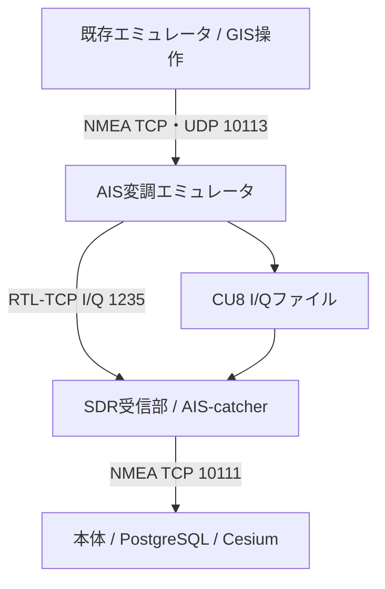

# AIS SDR送信エミュレータ（ソフトウェア試験用）

既存Webエミュレータが生成したNMEA AISをGMSK変調し、SDR受信部のAIS-catcherで実際に復調する試験環境です。DockerでMac/Windows/Linux、amd64/arm64を対象とします。アンテナやSDR送信機へのRF出力機能はありません。



## 起動

リポジトリルートで実行します。Docker Desktop（WindowsはLinuxコンテナ）またはDocker Engine + Compose v2を起動してください。Windowsは `python3` を `py -3` に読み替えます。

```sh
git pull --ff-only
python3 sdr-tx/setup.py
docker compose --env-file sdr-tx/.env -f sdr-tx/compose.yaml up -d --build --wait
```

送信管理画面は http://localhost:18083 。`sdr-tx/.env` の `SDR_TX_TOKEN` で接続します。コンテナ内Webは80です。8080/8888は使いません。トークンはブラウザ永続ストレージに保存しません。設定と生成済みI/QはDockerボリュームに保存します。再起動時は変調停止状態です。

SDR受信部も起動:

```sh
python3 sdr/setup.py
docker compose --env-file sdr/.env -f sdr/compose.yaml up -d --build --wait
```

本体と既存エミュレータは各READMEの手順で起動します。設定済み環境なら:

```sh
docker compose up -d --build --wait
docker compose -f emulator/compose.yaml up -d --build --wait
```

## 連接設定（同じDockerホスト）

|画面|設定|
|---|---|
|既存エミュレータ http://localhost:8090|出力方式 TCP（UDPも可）、ホスト `host.docker.internal`、ポート `10113`|
|送信エミュレータ http://localhost:18083|振幅0.65、雑音0、周波数ずれ0、正常FCSで保存|
|SDR受信部 http://localhost:18082|入力RTL-TCP、ホスト `host.docker.internal`、ポート `1235`、サンプルレート `288000` Hz、PPM 0|
|SDR受信部の配信先|TCP `host.docker.internal:10111`|
|本体 http://localhost:18081|受信開始|

受信部で「受信開始」→送信管理画面で「受信部 接続中」を確認→「変調開始」→既存エミュレータから送信します。既存のGIS操作、Type 5入力、全タイプ送信・自動周回がそのまま利用できます。別PCへの接続には該当PCのLAN IPを指定します。

管理Webは標準localhost限定です。Docker内からホスト経由でデータ接続できるよう、NMEA10113/TCP・UDPとI/Q1235/TCPは標準で全ホストインターフェースに公開します。必要なインターフェースだけに限定する場合は `.env` の `SDR_TX_DATA_BIND` を指定し、必要な端末間の接続を許可します。データポートは管理APIトークンによる認証を使用しません。試験ネットワーク内で利用してください。

## 変調仕様

- AIS 9600 bit/s、GMSK BT=0.4、変調指数0.5。
- NMEAチェックサム検証、送信元ごとの分割文再構成、オクテット内LSB-first、CRC-16/X-25 FCS、ビットスタッフィング、NRZI。
- 中心162 MHzに対しA=-25 kHz、B=+25 kHzの複素ベースバンド。
- CU8（I/Q交互、unsigned 8bit）、RTL-TCPヘッダー・サンプルレート指示に対応。
- ストリームのレートは288000 / 384000 / 768000 / 1536000 Hz。推奨288000 Hz。
- 振幅0.01～0.9、I/Q各成分の雑音標準偏差0～0.3、周波数ずれ±3000 Hz。雑音生成は再現可能な固定seed。
- FCS破損を選択すると、正常に復調されてもCRC検証で棄却される信号を生成。

受信接続は1台。最大256パケット、待機10秒を超えるデータは破棄します。停止・再接続時に古い送信待ちデータを再送しません。過負荷時の破棄件数を画面で確認できます。NMEA受信元はTCP最大32接続、UDP送信元最大64。断片は10秒で期限切れです。複数の船舶データは順次変調します。実際のSOTDMA/時分割割当、衝突、伝搬、送信電力・RF校正は再現しません。

AIVDO/VDMは入力時にペイロードを取り出します。無線受信後はAIVDM（他船情報）です。自己位置GPS/AIVDOのアプリ試験には既存の直接NMEA入力を使ってください。

## I/Qファイル試験

内蔵シナリオを選ぶかNMEAを貼り付け、「I/Qファイルを生成」→ダウンロード。1回128パケットまで。出力 `ais-162MHz-288k.cu8` を受信部の `sdr/iq/` に配置し、入力をファイル、形式CU8、288000 Hzに設定して再生します。内蔵ケースは既存エミュレータと同じ42シナリオです。

信号条件の保存は変調を停止します。設定変更後に再度「変調開始」を押してください。停止時もRTL-TCPのサンプル時計を維持するため無信号I/Q（設定した雑音を含む）を送り続けます。完全に切断するには受信部を停止します。

## 検証と判定

独立したAIS-catcher v0.70（受信部と同じ固定ソース）でI/Qを復調し、NMEAの断片を再構成した後のペイロードとチャネルを比較します。NMEA文の分割位置や連番では比較しません。非8bit境界の入力にはオクテット境界まで0を追加します。

42ケースのうち38ケースはビット一致、4ケースは以下の既知の棄却として検査します。棄却ケースも変調は実行するため、入力件数と復調件数は一致しません。

|ケース|固定受信エンジンでの棄却理由|
|---|---|
|type-0|予約タイプ0|
|type-15|元の試験データが172bitで、受信エンジンのType 15長さ上限を超える|
|type-25-broadcast|短い試験データがエンジンの最小72bit検証に適合しない|
|type-26-multipart|1008bitペイロードにFCS等を加えるとエンジン内の1024bit受信バッファ限界に達する|

Type 26は別途976bitの近上限データのビット一致も確認します。FCS破損の棄却と、雑音σ0.01・周波数ずれ+500 Hzの復調試験を含みます。これは受信エンジンの特性を示す試験で、4件を成功デコードとして数えません。

```sh
python3 -m pip install numpy==2.3.5
python3 -m unittest discover -s sdr-tx/tests -v
python3 sdr-tx/roundtrip.py
```

`roundtrip.py` は起動済みの受信コンテナで別のAIS-catcherプロセスにI/Qを渡します。受信コンテナの通常の受信は停止して実行してください。`smoke.py` は本体・エミュレータ・受信部・送信部がすべて起動した専用試験環境で使用し、既存エミュレータ→変調→RTL-TCP→受信部→本体DBを確認します。試験で本体に登録されたデータは残ります。

amd64/arm64の専用CIがDocker、復調比較、連接とブラウザ操作を検証します。Mac/Windows Docker Desktopの実環境確認、アンテナ・物理SDR受信機の試験は別途必要です。

参照: [ITU-R M.1371-5](https://www.itu.int/dms_pubrec/itu-r/rec/m/R-REC-M.1371-5-201402-S!!PDF-E.pdf)、[AIS-catcher](https://github.com/jvde-github/AIS-catcher)。
